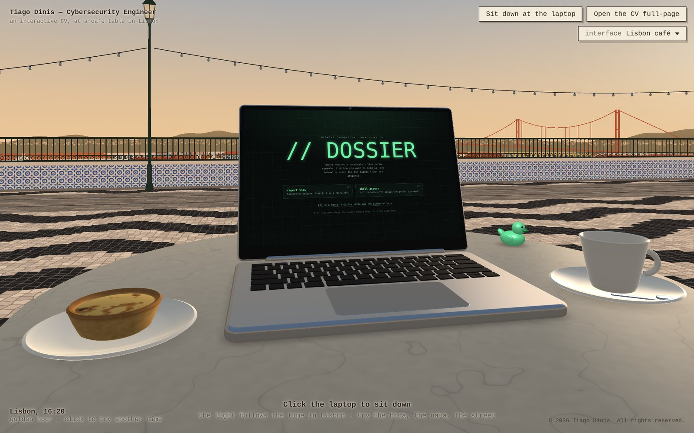
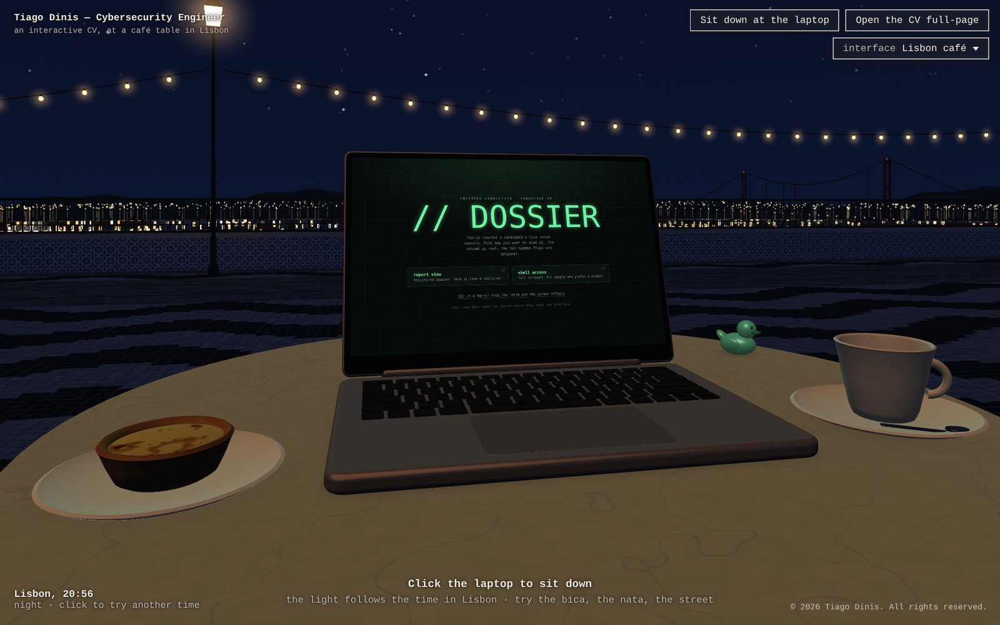
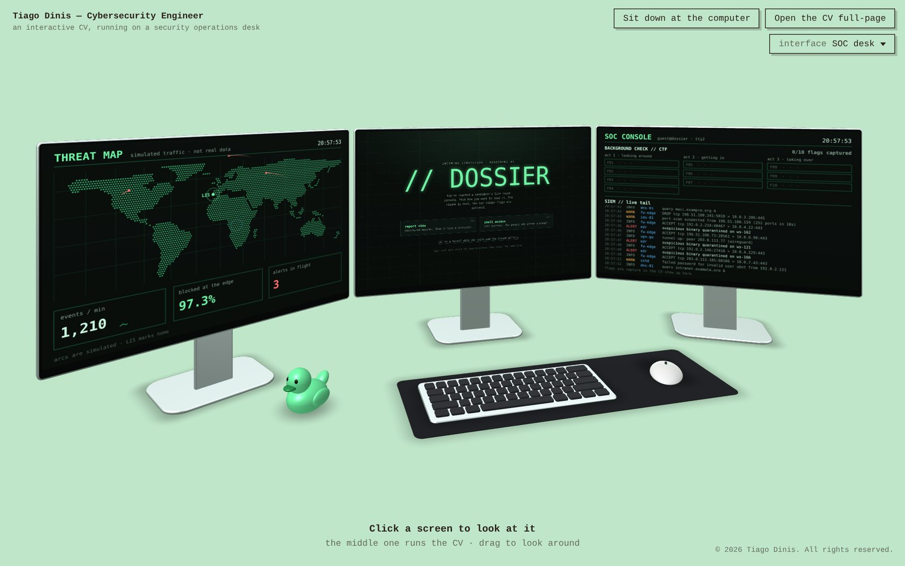
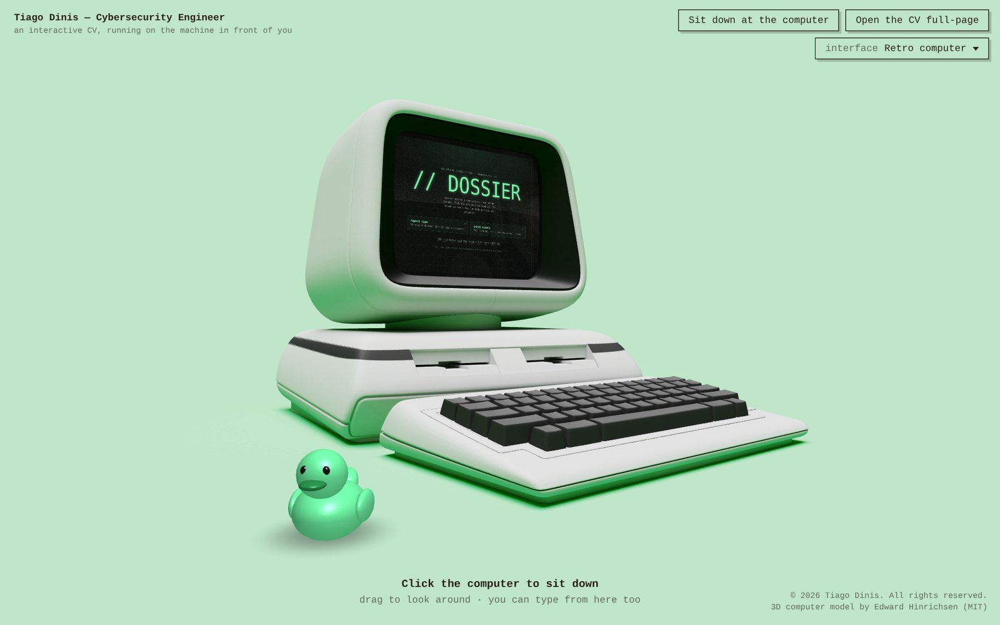
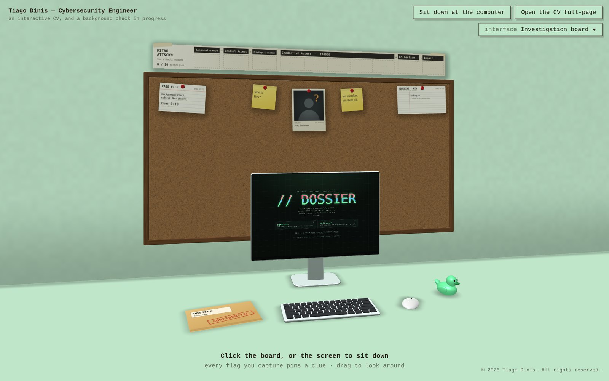
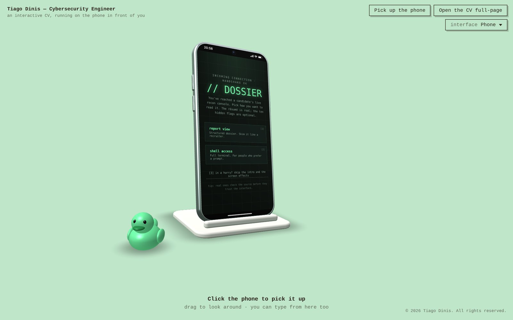
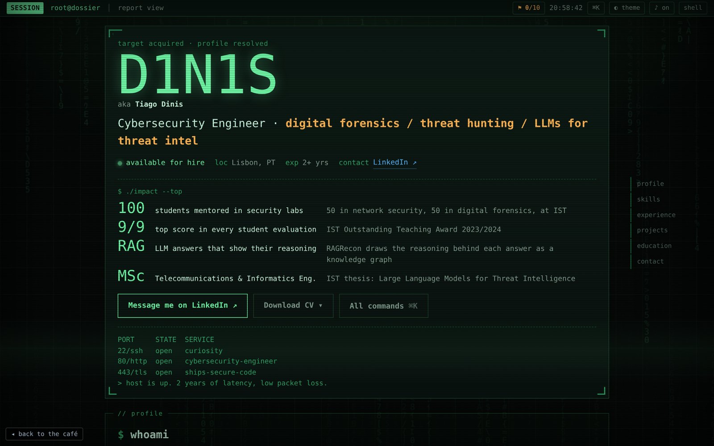
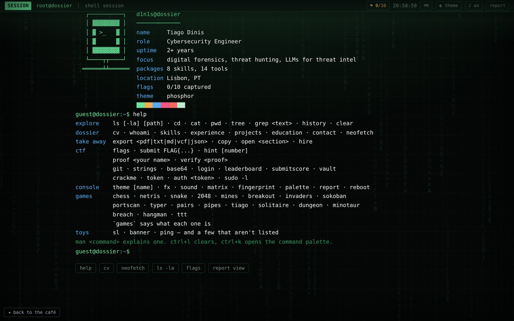
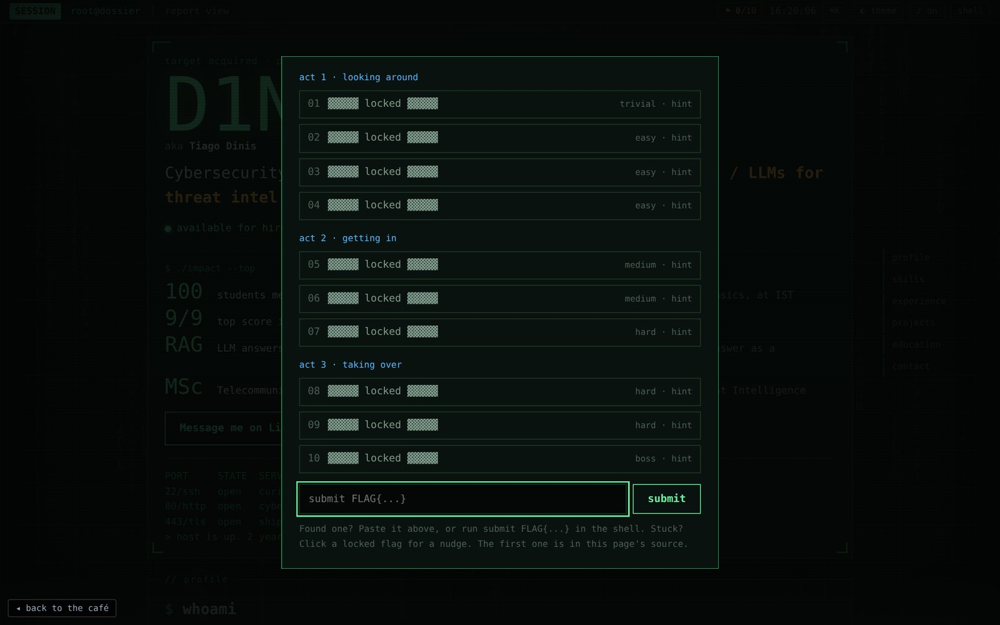
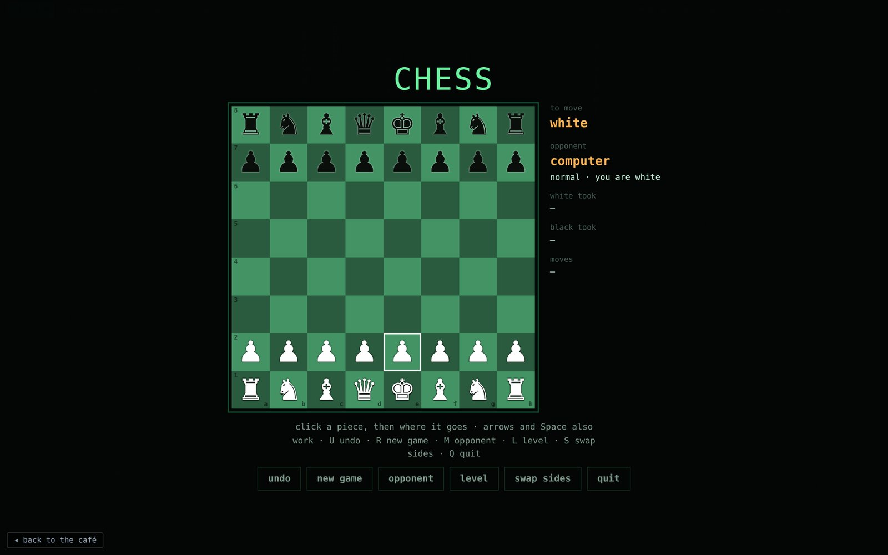

# DOSSIER

**The interactive CV of Tiago Dinis, Cybersecurity Engineer at Portugal's National Cybersecurity Centre (CNCS).**

DOSSIER is a résumé you can read in thirty seconds or explore for an hour. There's a clean report for the recruiter in a hurry, a working shell for the curious, a shelf of games, and a ten-flag CTF for anyone who wants to run a background check the hard way. It all runs in one static HTML file, in five 3D interfaces.

The Lisbon café, the default interface, at golden hour.

## The five interfaces

Pick one from the menu at the top right. Flags, scores and settings carry over when you switch. Every scene has a rubber duck, for debugging.

<table>
  <tr>
    <td width="50%" valign="top">
      
      <b>Lisbon café</b> <i>(default)</i>. A laptop on a café table over the river, with the 28 tram going by. The light follows the real time in Lisbon.
    </td>
    <td width="50%" valign="top">
      
      <b>SOC desk</b>. A simulated threat map, the CV, and a SOC console that tracks your CTF progress.
    </td>
  </tr>
  <tr>
    <td width="50%" valign="top">
      
      <b>Retro computer</b>. A 3D retro computer, with the model by Edward Hinrichsen (see <a href="#licence">Licence</a>).
    </td>
    <td width="50%" valign="top">
      
      <b>Investigation board</b>. A detective's desk where every flag you capture pins a clue to the board.
    </td>
  </tr>
  <tr>
    <td width="50%" valign="top">
      
      <b>Phone</b>. A phone on a desk. Pick it up to use the CV.
    </td>
    <td width="50%" valign="top">
      
      <b>Or skip the 3D</b>. <code>#report</code> opens the CV full-page.
    </td>
  </tr>
</table>

## What's inside

- **The report.** The résumé itself: profile, skills, experience, projects, education and headline numbers.
- **The shell.** A simulated terminal with its own file system. Type `help` to start. `cv`, `whoami`, `skills` and `contact` tell you about me, and `theme` switches between `phosphor`, `amber`, `ice` and `redteam`.
- **Games.** 19 of them, all playable inside the shell: `chess`, `netris`, `snake`, `2048`, `mines`, `breakout`, `invaders`, `sokoban`, `portscan`, `typer`, `pairs`, `pipes`, `tiago`, `solitaire`, `dungeon`, `minotaur`, `breach`, `hangman` and `ttt`. Type `games` to see what each one is.
- **The CTF: "Background check".** Ten flags in three acts. The machine was last looked after by Kev, an intern who did everything wrong, and each of his mistakes is a flag. Type `flags` to track your progress and `hint` if you're stuck. There's also one bonus flag hidden outside the story. Find all ten and you can sign a certificate with your name on it, which anyone can verify.
- **Take it with you.** The résumé downloads as PDF, plain text (pastes into any ATS), Markdown, a vCard contact card or [JSON Resume](https://jsonresume.org/).
- **Shortcuts.** `Ctrl/⌘ + K` opens the command palette, and `Ctrl/⌘ + P` prints a clean résumé from any screen.

<table>
  <tr>
    <td width="33%" valign="top">
      
      The shell, after <code>neofetch</code> and <code>help</code>.
    </td>
    <td width="33%" valign="top">
      
      The flag tracker: ten flags, three acts.
    </td>
    <td width="33%" valign="top">
      
      Chess against the machine, one of the 19 games.
    </td>
  </tr>
</table>

No spoilers here. The first flag is closer than you think.

## Running it

There's nothing to install or build. Open `index.html` in a browser, or publish the repository with GitHub Pages.

These links skip straight to a given view:

| Link | Opens |
|---|---|
| `index.html#soc` · `#retro` · `#board` · `#phone` | That interface |
| `index.html#report` | The résumé full-page, without the 3D |
| `index.html#plain` | The résumé with the screen effects off |
| `index.html#shell` | The terminal |

## Is the CTF safe to host?

Yes. It's a game, and every "system" in it (the git history, the staff portal and its database, the vault, the token check, `sudo`) is a few lines of JavaScript running in the visitor's own browser tab. The page is a static file with no server-side code, accounts or database behind it, and nothing a visitor types is sent anywhere. The script makes no network calls. The only thing the page loads from outside is its two web fonts.

Flags are checked against SHA-256 hashes and stored sealed, so they aren't sitting in the source as plain text. Certificates are signed with Ed25519 and checked in the browser.

## How it's built

- One self-contained HTML file with no frameworks, no dependencies and no build step.
- Every scene except the retro computer's model is built from code and drawn by a small standalone WebGL renderer (no three.js). The model and its textures are embedded at the end of the file.
- The CV (report, shell and CTF) lives in a single block marked `id="cv-source"`. Each of the five interfaces is a complete page of its own, kept in the block marked `id="rooms"` and opened in a frame when it's picked. The next one loads out of sight and fades in over the current one.
- It respects `prefers-reduced-motion`.

## Contact

The best way to reach me is [LinkedIn](https://linkedin.com/in/tiago-dinis-073544252).

## Licence

© 2026 Tiago Dinis. **All rights reserved.** See [LICENSE](LICENSE).

The CV and its text, the report, the shell, the games, the CTF and its story, and the code that runs them are my work. That includes the 3D scenes, the WebGL renderer that draws them, the page that switches between them, and the screenshots in this repository. They may not be copied, re-hosted or reused, in whole or in part, without my written permission. To ask, message me on [LinkedIn](https://linkedin.com/in/tiago-dinis-073544252).

**Not covered by this notice:**

- The retro computer's 3D model, its baked textures, environment map and camera choreography are from *retro-computer-website* by Edward Hinrichsen, © 2024, used under the MIT License. The full licence text is in [LICENSE](LICENSE) and at the top of `index.html`.
- The web fonts, [JetBrains Mono](https://www.jetbrains.com/lp/mono/) and [VT323](https://fonts.google.com/specimen/VT323), keep their own licences (SIL Open Font License).
